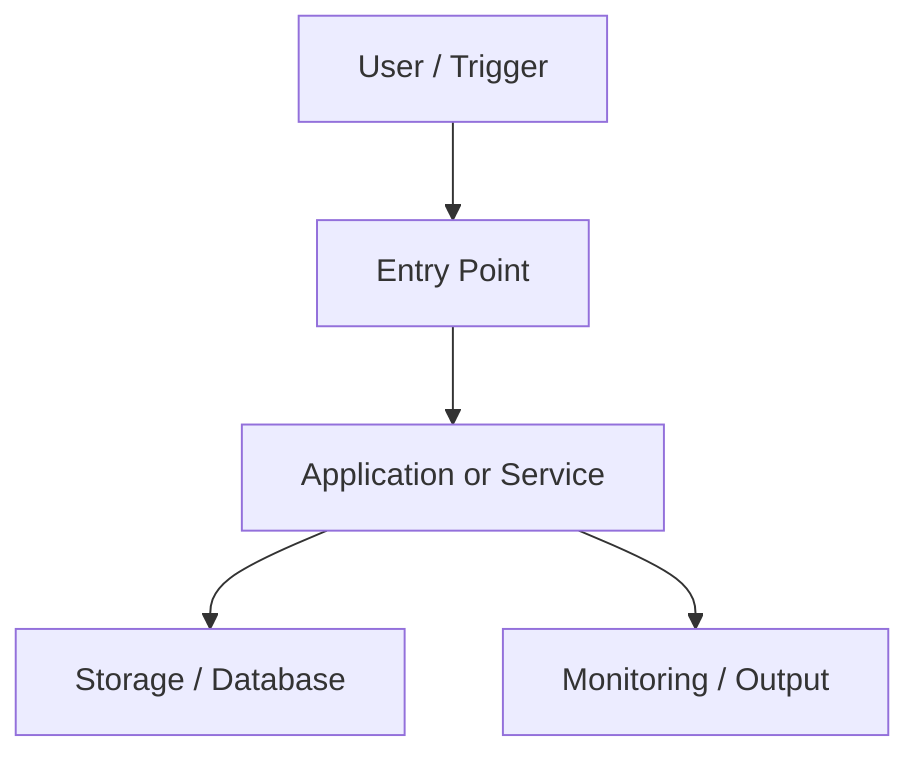

# Project Name

> One-sentence summary of the project.

## 1. Project Overview
Explain what the project does, its main features, intended users, and the outcome.

## 2. Problem Statement
- **Problem:** What issue or opportunity motivated this project?
- **Why it matters:** Who experiences this problem and what is its impact?
- **Goal:** What does a successful solution look like?

## 3. Architecture

Describe the infrastructure and end-to-end workflow. Replace the sample Mermaid diagram with your actual architecture.



### Workflow
1. Describe how the process starts.
2. Explain how requests or data move through the system.
3. Explain processing, storage, and outputs.
4. Describe monitoring, security, and failure handling.

## 4. Technologies
| Technology / Service | Purpose |
|---|---|
| Add technology | Explain how it is used |

## 5. Prerequisites
List required accounts, software, versions, permissions, tools, and estimated costs.

- Operating system:
- Runtime / language:
- Cloud account and permissions:
- CLI tools:
- Required environment variables:

> Never commit credentials, access keys, tokens, `.env` files, or other secrets. Use environment variables or a secrets manager.

## 6. Implementation

### Step 1 — Clone the repository
```bash
git clone <repository-url>
cd <repository-directory>
```

### Step 2 — Configure
Document configuration steps. Provide a safe `.env.example` containing placeholders only.

### Step 3 — Install dependencies
```bash
# Replace with the actual install command
```

### Step 4 — Deploy / Run
```bash
# Replace with the actual run or deployment command
```

### Step 5 — Verify
Explain how to confirm that the project works and what successful output looks like.

## 7. Troubleshooting
| Issue | Likely cause | Solution |
|---|---|---|
| Add observed issue | Explain the cause | Document the verified fix |

Include relevant logs or error messages with secrets and personal data removed.

## 8. Screenshots
Add screenshots that demonstrate the working result. Store them in a repository folder such as `docs/images/`.

```md


```

For each image, add a short caption explaining what it proves. Redact account IDs, public IPs where appropriate, credentials, personal information, and sensitive infrastructure details.

## 9. Cleanup
Explain how to remove every resource created by this project and prevent unexpected cloud charges.

### Cleanup checklist
- [ ] Stop or delete compute resources.
- [ ] Delete load balancers, gateways, IP addresses, and networking resources created for this project.
- [ ] Empty and delete project-specific storage buckets if appropriate.
- [ ] Delete databases, snapshots, backups, logs, and container images if no longer needed.
- [ ] Remove DNS records and certificates created only for this project.
- [ ] Revoke temporary credentials and remove unused IAM roles/policies.
- [ ] Check the cloud billing dashboard and budgets for remaining charges.

### AWS-specific notes (if applicable)
Document the exact AWS resources created and their deletion order. Include the verified commands or console paths. Check dependencies before deleting resources. Do not blindly run broad deletion commands.

**Verification:** Explain how to confirm that the resources are gone and no project-specific services remain active.

---

## License
Specify the license, or state that the project is not currently licensed for reuse.
